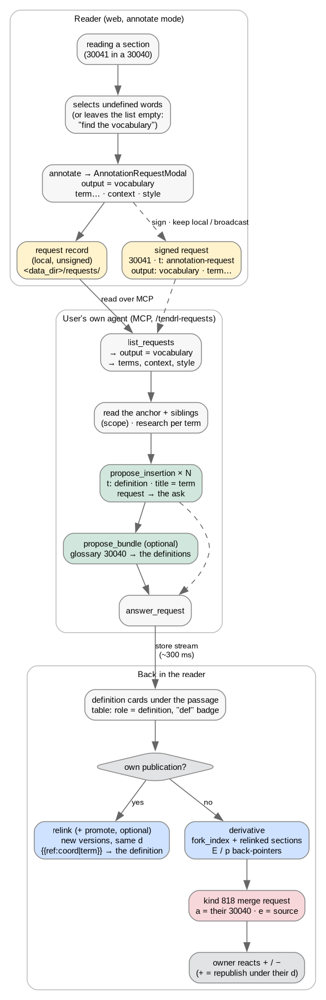
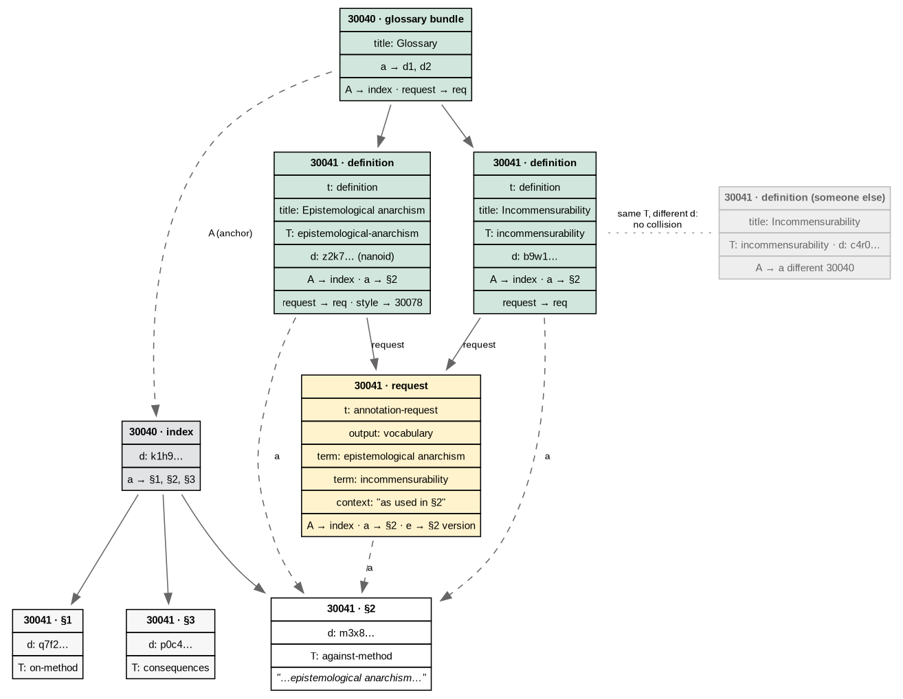
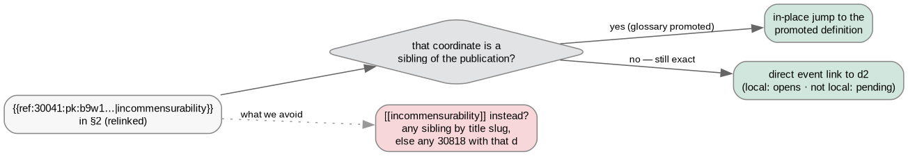
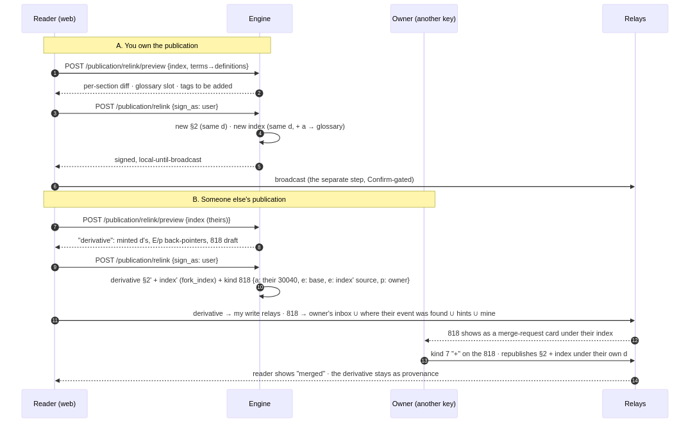
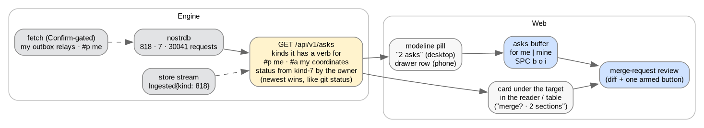
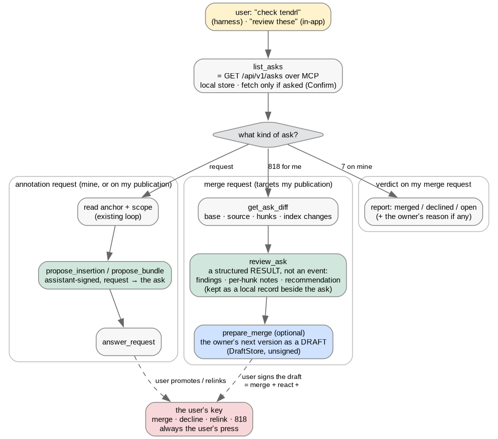

#+TITLE: Vocabulary requests — unpack the words a text leaves undefined
#+SUBTITLE: Mock-up of the workflow, the events, and where each step lands (plan Phase 5c)
#+DATE: 2026-09-23
#+STATUS: mock-up (design/vocabulary-requests, off feat/annotations-table) · interactive prototype (no engine, fake data): https://claude.ai/artifact/JFf3nz9UQjPLew6oBj96oB
#+STARTUP: inlineimages showall
#+OPTIONS: ^:nil toc:2
#+PROPERTY: header-args:dot :exports results :cmd dot :cmdline -Tpng -Gdpi=110
#+PROPERTY: header-args:mermaid :exports results

Every diagram below is a source block with its rendered PNG under
=docs/vocabulary/= checked in beside it. =C-c C-c= on a block re-renders
(ob-dot is built in; the sequence diagram needs =ob-mermaid= + =mmdc=).
=C-c C-x C-v= toggles the inline images if =#+STARTUP: inlineimages=
did not already show them.

* The idea in one paragraph

A reader hits a word the text uses but never defines. Today they can ask
for /notes/ on the passage (annotate mode → a request record → their own
agent answers with insertions). A *vocabulary request* is the same ask
with a different =output=: "unpack these words, with respect to this
text". The answers are *definition sections* — ordinary kind-30041
insertions tagged =t: definition=, one per term, anchored to the passage
that needed them, several per term allowed because a 30041's =d= is an
opaque nanoid (unlike NIP-54's slug-as-=d=, which gives every author one
article per word). One event per term holds everything relevant to
it — the sense here, background, expansion — rather than a definition
plus side notes. The text is then *relinked*: each term becomes a
nostrdown ={{ref:<coordinate>|term}}= pointing at /that one definition
event/ — not a =[[term]]= wikilink, which unpacks to every article whose
=d= happens to match. A coordinate ref resolves sibling-first and
otherwise as a direct pointer, so it works whether or not the definition
is ever promoted; promotion into a glossary is optional and only puts the
definitions in the reading order. Relinking is a new version of each
section under its own =d= when you own the publication; for someone
else's, it is a derivative plus a *kind-818 merge request* that asks them
to take it.

* The annotate modal, for vocabulary

Not a term list. The modal shows the *section's own content* and the
user marks words in it: hover shows the word under the pointer, a
drag over a word or phrase highlights it, a click on a highlighted
word removes that highlight. The highlights are the =term= tags. The
event's =content= is generated, not typed:

#+begin_example
define these words in the context of these events: epistemological anarchism, incommensurability
#+end_example

where "these events" are the anchor tags (=A=/=a=/=e=) and whatever the
=scope= chips add. No highlights = "find the words these events use but
never define, and define them in their context". The paragraphs the
highlights fall in travel as =context=.

*Event preview is the general pattern.* Every modal that creates an
event shows the unsigned JSON it will sign — the tags as they will be
emitted — the way the event menu shows an event. The annotate modal,
the relink/fork preview (the derivative + the 818), and the merge
review (the owner's next version) all end in that preview before the
armed button.

* Actors and events

| Piece                 | Kind  | Owner            | Tags that matter                                                         | Exists today?                       |
|-----------------------+-------+------------------+--------------------------------------------------------------------------+-------------------------------------|
| Publication index     | 30040 | author           | =a= per section, =title=, =d=                                            | yes                                 |
| Section               | 30041 | author           | =d= (nanoid), =title=, =T= (slug), =m= (mime)                            | yes                                 |
| Vocabulary request    | 30041 | reader (signed)  | =t annotation-request=, =output vocabulary=, =term …=, =context=, =style= | =output= is =notes= / =kasten= today |
|                       | local | reader (unsigned)| same fields in =<data_dir>/requests/=                                    | yes                                 |
| Definition            | 30041 | reader's agent   | =t definition=, =title= = the term, =T= = slug, =A=/=a=/=e= anchor, =request= | new role                            |
| Glossary bundle       | 30040 | reader's agent   | =a= per definition, =A=/=K=/=P= anchor, =request=                        | bundle insertions exist             |
| Relinked section      | 30041 | owner / forker   | content with ={{ref:<coord>\vert{}term}}=, =a= per definition (emitted by =reference_tags=) | =a= emission exists                 |
| Derivative index      | 30040 | forker           | every tag copied, =E= + =p= back to the original                         | =fork_index= exists                 |
| Merge request         | 818   | forker           | =a= target (30040/30041), =e= base, =e … source=, =p= owner              | NIP-54, extended to NKBIP-01 kinds  |
| Accept / reject       | 7     | owner            | =e= the 818, content =+= / =-=                                           | NIP-25                              |

* The workflow

#+begin_src dot :file vocabulary/workflow.png
digraph workflow {
  rankdir=TB; fontname="Helvetica"; node [fontname="Helvetica", fontsize=10, shape=box, style="rounded,filled", fillcolor="#f7f7f7", color="#888"];
  edge [fontname="Helvetica", fontsize=9, color="#666"];

  subgraph cluster_reader { label="Reader (web, annotate mode)"; style="rounded"; color="#bbb"; fontsize=10;
    read   [label="reading a section\n(30041 in a 30040)"];
    select [label="selects undefined words\n(or leaves the list empty:\n\"find the vocabulary\")"];
    ask    [label="annotate → AnnotationRequestModal\noutput = vocabulary\nterm… · context · style"];
    record [label="request record\n(local, unsigned)\n<data_dir>/requests/", fillcolor="#fff3cd"];
    signed [label="signed request\n30041 · t: annotation-request\noutput: vocabulary · term…", fillcolor="#fff3cd"];
    read -> select -> ask -> record;
    ask -> signed [label="sign · keep local / broadcast", style=dashed];
  }

  subgraph cluster_agent { label="User's own agent (MCP, /tendrl-requests)"; style="rounded"; color="#bbb"; fontsize=10;
    list   [label="list_requests\n→ output = vocabulary\n→ terms, context, style"];
    research [label="read the anchor + siblings\n(scope) · research per term"];
    defs   [label="propose_insertion × N\nt: definition · title = term\nrequest → the ask", fillcolor="#d1e7dd"];
    bundle [label="propose_bundle (optional)\nglossary 30040 → the definitions", fillcolor="#d1e7dd"];
    close  [label="answer_request"];
    list -> research -> defs -> bundle -> close;
    defs -> close [style=dashed];
  }

  subgraph cluster_fold { label="Back in the reader"; style="rounded"; color="#bbb"; fontsize=10;
    cards  [label="definition cards under the passage\ntable: role = definition, \"def\" badge"];
    own    [label="own publication?", shape=diamond, fillcolor="#e2e3e5"];
    relink [label="relink (+ promote, optional)\nnew versions, same d\n{{ref:coord|term}} → the definition", fillcolor="#cfe2ff"];
    fork   [label="derivative\nfork_index + relinked sections\nE / p back-pointers", fillcolor="#cfe2ff"];
    mr     [label="kind 818 merge request\na = their 30040 · e = source", fillcolor="#f8d7da"];
    react  [label="owner reacts + / −\n(+ = republish under their d)", fillcolor="#e2e3e5"];
    cards -> own;
    own -> relink [label="yes"];
    own -> fork   [label="no"];
    fork -> mr -> react;
  }

  record -> list [label="read over MCP", lhead=cluster_agent];
  signed -> list [style=dashed];
  close -> cards [label="store stream\n(~300 ms)"];
}
#+end_src

#+RESULTS:

The three clusters are three moments, hours apart. Nothing in the
middle wakes an agent: the user types "check tendrl requests" in their
own harness, as today
([[file:zettel/decision-requests-are-events.org][decision]]).

* The event graph after an answer

What the store holds once the agent has answered a two-term request on
section 2 of a three-section publication, before anything is promoted.

#+begin_src dot :file vocabulary/events.png
digraph events {
  rankdir=TB; nodesep=0.35; ranksep=0.55; fontname="Helvetica";
  node [fontname="Helvetica", fontsize=10, shape=plaintext];
  edge [fontname="Helvetica", fontsize=9, color="#666"];

  idx [label=<<table border="0" cellborder="1" cellspacing="0" cellpadding="4" bgcolor="#e2e3e5">
    <tr><td><b>30040 · index</b></td></tr><tr><td>d: k1h9…</td></tr><tr><td>a → §1, §2, §3</td></tr></table>>];
  s1 [label=<<table border="0" cellborder="1" cellspacing="0" cellpadding="4" bgcolor="#f7f7f7">
    <tr><td><b>30041 · §1</b></td></tr><tr><td>d: q7f2…</td></tr><tr><td>T: on-method</td></tr></table>>];
  s2 [label=<<table border="0" cellborder="1" cellspacing="0" cellpadding="4" bgcolor="#ffffff">
    <tr><td><b>30041 · §2</b></td></tr><tr><td>d: m3x8…</td></tr><tr><td>T: against-method</td></tr>
    <tr><td><i>"…epistemological anarchism…"</i></td></tr></table>>];
  s3 [label=<<table border="0" cellborder="1" cellspacing="0" cellpadding="4" bgcolor="#f7f7f7">
    <tr><td><b>30041 · §3</b></td></tr><tr><td>d: p0c4…</td></tr><tr><td>T: consequences</td></tr></table>>];
  idx -> s1; idx -> s2; idx -> s3;

  req [label=<<table border="0" cellborder="1" cellspacing="0" cellpadding="4" bgcolor="#fff3cd">
    <tr><td><b>30041 · request</b></td></tr><tr><td>t: annotation-request</td></tr><tr><td>output: vocabulary</td></tr>
    <tr><td>term: epistemological anarchism</td></tr><tr><td>term: incommensurability</td></tr>
    <tr><td>context: "as used in §2"</td></tr><tr><td>A → index · a → §2 · e → §2 version</td></tr></table>>];
  req -> s2 [label="a", style=dashed];

  d1 [label=<<table border="0" cellborder="1" cellspacing="0" cellpadding="4" bgcolor="#d1e7dd">
    <tr><td><b>30041 · definition</b></td></tr><tr><td>t: definition</td></tr>
    <tr><td>title: Epistemological anarchism</td></tr><tr><td>T: epistemological-anarchism</td></tr>
    <tr><td>d: z2k7… (nanoid)</td></tr><tr><td>A → index · a → §2</td></tr>
    <tr><td>request → req · style → 30078</td></tr></table>>];
  d2 [label=<<table border="0" cellborder="1" cellspacing="0" cellpadding="4" bgcolor="#d1e7dd">
    <tr><td><b>30041 · definition</b></td></tr><tr><td>t: definition</td></tr>
    <tr><td>title: Incommensurability</td></tr><tr><td>T: incommensurability</td></tr>
    <tr><td>d: b9w1…</td></tr><tr><td>A → index · a → §2</td></tr><tr><td>request → req</td></tr></table>>];
  d1 -> req [label="request"]; d2 -> req [label="request"];
  d1 -> s2 [label="a", style=dashed]; d2 -> s2 [label="a", style=dashed];

  gl [label=<<table border="0" cellborder="1" cellspacing="0" cellpadding="4" bgcolor="#d1e7dd">
    <tr><td><b>30040 · glossary bundle</b></td></tr><tr><td>title: Glossary</td></tr>
    <tr><td>a → d1, d2</td></tr><tr><td>A → index · request → req</td></tr></table>>];
  gl -> d1; gl -> d2;
  gl -> idx [label="A (anchor)", style=dashed, constraint=false];

  other [label=<<table border="0" cellborder="1" cellspacing="0" cellpadding="4" bgcolor="#eeeeee" color="#bbbbbb">
    <tr><td><b>30041 · definition (someone else)</b></td></tr>
    <tr><td>title: Incommensurability</td></tr>
    <tr><td>T: incommensurability · d: c4r0…</td></tr>
    <tr><td>A → a different 30040</td></tr></table>>];
  other -> d2 [label="same T, different d:
no collision", style=dotted, color="#999", dir=none, constraint=false];

  { rank=same; s1; s2; s3; }
  { rank=same; d1; d2; other; }
}
#+end_src

#+RESULTS:

Two things the graph shows on purpose:

- The request is *answered* because two events point at it with
  =request=; nothing records that state. This is the existing rule.
- A second "Incommensurability" by another hand is a separate 30041 with
  its own =d=. Under NIP-54 both would be =d: incommensurability= and
  only one could exist per key.

* Relink: before and after

The one new algorithm. Engine-side, pure, in =nostrdown.rs=: wrap the
first plain-text occurrence of each term per section in a
={{ref:<definition coordinate>|<term as written>}}=, skipping code
spans, headings, existing links and anything already inside ={{ }}=;
per markup format. The display part keeps the author's wording and
case; the target is the definition's coordinate, so the link names one
event and nothing else. =reference_tags= then emits an =a= tag per
definition on publish, as it already does for any coordinate ref — so
=a:<definition coord>= finds every section that cites it.

#+begin_example
── §2 (Markdown), before ─────────────────────────────────────────────
Feyerabend's epistemological anarchism holds that science advances by
breaking its own rules; the incommensurability of paradigms is the
reason no single method survives contact with history.

── §2, after relink (new version, same d) ────────────────────────────
Feyerabend's {{ref:30041:<agent-pk>:z2k7…|epistemological anarchism}}
holds that science advances by breaking its own rules; the
{{ref:30041:<agent-pk>:b9w1…|incommensurability}} of paradigms is the
reason no single method survives contact with history.

tags added by reference_tags:
  ["a", "30041:<agent-pk>:z2k7…"]
  ["a", "30041:<agent-pk>:b9w1…"]

(not [[incommensurability]] — a wikilink unpacks to any 30818 whose d
matches, or any sibling whose title slug matches; the ref names one.)
#+end_example

Resolution needs nothing new: =resolve_refs= already treats an entity
=ref:= as sibling-first, then a direct event pointer (decided 2026-09-15,
the target form sets the scope). Promoted or not, the reader lands on
the definition; promotion only changes whether it is an in-place jump
or an event link.

#+begin_src dot :file vocabulary/resolve.png
digraph resolve {
  rankdir=LR; fontname="Helvetica"; node [fontname="Helvetica", fontsize=10, shape=box, style="rounded,filled", fillcolor="#f7f7f7", color="#888"];
  edge [fontname="Helvetica", fontsize=9, color="#666"];
  link [label="{{ref:30041:pk:b9w1…|incommensurability}}
in §2 (relinked)"];
  sib  [label="that coordinate is a
sibling of the publication?", shape=diamond, fillcolor="#e2e3e5"];
  def  [label="in-place jump to the
promoted definition", fillcolor="#d1e7dd"];
  ev   [label="direct event link to d2
(local: opens · not local: pending)", fillcolor="#d1e7dd"];
  wiki [label="[[incommensurability]] instead?
any sibling by title slug,
else any 30818 with that d", fillcolor="#f8d7da"];
  link -> sib;
  sib -> def [label="yes (glossary promoted)"];
  sib -> ev  [label="no — still exact"];
  link -> wiki [label="what we avoid", style=dotted, color="#999"];
}
#+end_src

#+RESULTS:

* Own publication vs someone else's

#+begin_src mermaid :file vocabulary/merge.png :width 1100
sequenceDiagram
    autonumber
    participant R as Reader (web)
    participant E as Engine
    participant O as Owner (another key)
    participant N as Relays

    Note over R,E: A. You own the publication
    R->>E: POST /publication/relink/preview {index, terms→definitions}
    E-->>R: per-section diff · glossary slot · tags to be added
    R->>E: POST /publication/relink {sign_as: user}
    E->>E: new §2 (same d) · new index (same d, + a → glossary)
    E-->>R: signed, local-until-broadcast
    R->>N: broadcast (the separate step, Confirm-gated)

    Note over R,O: B. Someone else's publication
    R->>E: POST /publication/relink/preview {index (theirs)}
    E-->>R: "derivative": minted d's, E/p back-pointers, 818 draft
    R->>E: POST /publication/relink {sign_as: user}
    E->>E: derivative §2' + index' (fork_index) + kind 818 {a: their 30040, e: base, e: index' source, p: owner}
    R->>N: derivative → my write relays · 818 → owner's inbox ∪ where their event was found ∪ hints ∪ mine
    N-->>O: 818 shows as a merge-request card under their index
    O->>N: kind 7 "+" on the 818 · republishes §2 + index under their own d
    N-->>R: reader shows "merged" · the derivative stays as provenance
#+end_src

#+RESULTS:

Path A is the common case for a reader-writer and needs no request
event at all. Path B reuses =fork_index= for the index and adds the same
copy process for the relinked sections; the 818 is the only new event,
and it is NIP-54's with the target kind widened to 30040/30041 (a stated
extension in =nips/NKBIP-01-insertions.org=, since NIP-54 says the
source MUST be a 30818).

* What the reader shows

#+begin_example
┌─ §2 · Against Method ───────────────────────────────────────────────┐
│ Feyerabend's {{ref:…|epistemological anarchism}} holds that science …│
│                                                                      │
│ ▌ ? request · answered      vocabulary · 2 terms · ✎ glossary style  │
│ ▌   ↳ 2 definitions                                                  │
│ ▌ def  Epistemological anarchism            you·agent · 12:40        │
│ ▌      The view, after Feyerabend, that no fixed method …            │
│ ▌      [open as section ▸] [promote → glossary]   ← per event        │
│ ▌ def  Incommensurability                   you·agent · 12:41        │
│ ▌      Two paradigms are incommensurable when …                      │
│ ▌      [open as section ▸] [in glossary · §4 · remove]               │
│                                                                      │
│ [relink 2 terms into the text ▸]   ← armed button, diff gate first   │
└──────────────────────────────────────────────────────────────────────┘

Annotations table:  role = definition → "def" badge, term chip;
                    counts exclude requests as today, include definitions.
Foreign publication: the same card, the button reads
                    [fork + merge request ▸] and previews the 818.
#+end_example

* Where each step lands

| Step                              | Engine (Rust)                                                                   | Web (TS)                                                    |
|-----------------------------------+---------------------------------------------------------------------------------+-------------------------------------------------------------|
| =output: vocabulary= + =term= tags | =requests.rs= (record + 30041 template), =tools.rs::list_requests= hands terms | =AnnotationRequestModal=: third seg, term chips from selection |
| Definition role                   | =insertion.rs::InsertionRole::Definition= (from =t definition=), load pass      | =InsertionCard= "def" badge, table =role= filter             |
| Agent answers                     | =propose_insertion= gains =role: definition= (sets =t=, =T= from title)         | =/tendrl-requests= skill: vocabulary branch                 |
| Glossary bundle                   | =propose_bundle= unchanged                                                      | bundle card as today                                        |
| Relink transform                  | =nostrdown::link_terms(content, format, [(term, coord)]) -> (content, changed)=, pure; emits ={{ref:coord\vert{}term}}= | diff gate (existing primitive)                              |
| Relink publish                    | =POST /publication/relink= (+ =/preview=): own → same =d=; else derivative      | armed button on the request card                            |
| Merge request                     | =publication/merge_request.rs=: 818 template + parse; card data in load pass    | =MergeRequestCard= under the target                         |
| Accept                            | kind-7 on the 818 + republish (owner side)                                      | one armed button on the card                                |

* Merge requests: the inbox, the review, the diff

A kind-818 is addressed (=p= the owner) and it asks for a decision. That
is the one shape of "notification" tendrl should have: not a stream of
everything that mentions you, but *events of a kind that wants an act
from you*, counted, never pushed. The mission's dial
([[file:zettel/mission.org][orientation dials]]) and the resurfacing idea
say the same thing: an entry point, a modeline count, never an
interruption.

** What counts: a default the user extends

The engine ships a default set — the kinds it has a verb for — and the
user *appends* kinds they want to hear about. So the same list can
carry "someone highlighted your section" for the person who wants it
and stay silent for the one who does not. Comments, highlights and
reactions are not asks by default; they become *activity* when opted
in, listed below the asks, with no verb but "read".

|                        Kind | Addressed how (the engine's rule)     | You are   | Verb                              | Default |
|-----------------------------+---------------------------------------+-----------+-----------------------------------+---------|
|                         818 | =p= you, or =a= one of your 30040/30041   | owner     | review the diff, merge or decline | on      |
|                           7 | =e= an 818 you sent                     | requester | see the verdict                   | on      |
| 30041 =t: annotation-request= | =A= your publication (signed)           | owner     | answer it yourself, or ignore     | on      |
|                        1111 | =A=/=a= your coordinates, or =P=/=p= you  | author    | read, reply in place              | off     |
|                        9802 | =a= your coordinate, or =p= you           | author    | read ("N highlighted §2")         | off     |
|                           7 | =e=/=a= any event of yours (not an 818) | author    | read                              | off     |
|                        9735 | =p= you (zap receipt)                   | author    | read                              | off     |
|                         any | =p= you                                 | —         | read                              | off     |

The rule column is the point: for each kind the *engine* knows what
"addressed to me" means (a tag, not a search), so adding a kind is a
preference, not a query the web has to build. An unknown kind gets the
generic =p= rule. Muted authors and the ignore list apply before
anything is counted, as they do for insertions.

** The notifications drawer

Not a settings page about asks: a *notifications drawer* — tendrl's
one surface for "what can it tell me about". It is a *checkable list*
of the event kinds tendrl has a verb for, not a free kind-number
field; what is checked is what the modeline shows on desktop and what
the ☰ drawer's status section shows on the phone (next to agent
services and relay status). Asks are the rows that need an act; the
rest is activity. Each row is a kind, the
engine's one-line rule shown back ("9802 · a highlight of one of your
sections"), a checkbox, and whether it counts toward the modeline
number or only shows in the list. The default acts are checked and
fixed; the rest start unchecked. A kind appears here the day the
engine gains a verb for it, so the list is the engine's table, mirrored. Persisted engine-side in
=<data_dir>/notifications.json= (like =relays.json= / =providers.json=: local
state, never a Nostr event — nothing about what you want to hear is
published), so both shells and =list_asks= over MCP honour the same
set.

#+begin_example
Notifications — what tendrl can tell you about

  on   818   merge requests on your publications            act   default
  on   7     verdicts on merge requests you sent             act   default
  on   30041 signed annotation requests on your publications act   default
  ─────────────────────────────────────────────────────────────────────
  on   9802  highlights of your sections                     count  ×
  on   1111  comments on your publications                   list   ×
  off  7     reactions to anything of yours                  list   ×
  off  9735  zaps to you                                     list   ×
  off  30045 someone shelved your publication                 list   ×

  count = adds to the modeline number · list = shows in the notifications list only
  (desktop: modeline pill · phone: ☰ drawer › status)
#+end_example

The modeline pill is then "2 asks · 5 new" — acts first, activity
second, and the second half is whatever the user turned on. Nothing
here is a push; the number sits there until the buffer is opened.
=fetch_asks= pulls exactly the enabled kinds with =#p me= (plus =#a= /
=#A= on your coordinates for the kinds whose rule is the coordinate) —
one filter per rule, on your read relays.

** Where it lives

#+begin_src dot :file vocabulary/inbox.png
digraph inbox {
  rankdir=LR; fontname="Helvetica"; node [fontname="Helvetica", fontsize=10, shape=box, style="rounded,filled", fillcolor="#f7f7f7", color="#888"];
  edge [fontname="Helvetica", fontsize=9, color="#666"];

  subgraph cluster_engine { label="Engine"; style="rounded"; color="#bbb"; fontsize=10;
    store  [label="nostrdb\n818 · 7 · 30041 requests", fillcolor="#e2e3e5"];
    prefs  [label="notifications.json\ndefault kinds + the user's\n(rule per kind, count | list)", fillcolor="#fff3cd"];
    asks   [label="GET /api/v1/asks\nenabled kinds · engine's rule per kind\n#p me · #a / #A my coordinates\nstatus from kind-7 by the owner\n(newest wins, like git status)", fillcolor="#fff3cd"];
    prefs -> asks;
    stream [label="store stream\nIngested{kind: 818}", fillcolor="#e2e3e5"];
    fetch  [label="fetch (Confirm-gated)\nmy READ (inbox) relays · #p me\n(kind-10002 read entries)", fillcolor="#e2e3e5"];
    store -> asks; stream -> asks [style=dashed]; fetch -> store [style=dashed];
  }

  subgraph cluster_web { label="Web"; style="rounded"; color="#bbb"; fontsize=10;
    pill   [label="notifications\nmodeline pill (desktop)\n☰ drawer › status (phone)\n\"2 asks · 5 new\""];
    buf    [label="asks list = AnnotationsList\nacross publications, grouped\n(cards coloured as asks)", fillcolor="#cfe2ff"];
    review [label="merge-request review\n(diff + one armed button)", fillcolor="#cfe2ff"];
    card   [label="the same card under its anchor\nin the reader / table\n(\"merge? · 2 sections\")"];
    pill -> buf -> review;
    card -> review;
  }
  asks -> pill; asks -> card;
}
#+end_src

#+RESULTS:

- *One engine list*, =GET /api/v1/asks= (=?role=owner|requester&status=open|all=):
  818s whose =p= is you or whose =a= is one of your coordinates, plus
  your own outgoing 818s with the verdict folded on. Status is derived
  on every read from the newest kind-7 by the target owner, exactly
  the way =git.rs= resolves issue status; nothing is recorded. The store
  stream already emits =Ingested= per kind, so an open inbox updates
  without a refresh. Pulling new asks from relays is a fetch like any
  other: Confirm-gated, =#p= you on your *read* relays — the inbox
  half of your kind 10002, where others write to reach you (NIP-65).
  See /Relay routing/ below.
- *An ask is an annotation.* An 818 has an anchor (its =a= target) and
  a body (what it asks), so it renders as the same card everything
  else does — under its section in the reader, on the annotations
  table — coloured as an ask and structured like a comment with an
  anchor. No ask-specific surface. The cross-publication view is that
  same card list (=AnnotationsList=) grouped by publication, opened
  from the modeline count (a pill next to agent services; the drawer's
  status section on the phone). Opening a card jumps to its anchor;
  the review sits on the card.
- *Never a push.* No OS notification, no badge that demands clearing.
  An ignored 818 just stays open; the requester sees "open" on their
  side and nothing more.

** Relay routing (NIP-65 + provenance)

Asks travel the inbox/outbox way round, not the publish way round. The
engine builds the *destination set* for anything addressed to another
pubkey — a signed annotation request on their publication, an 818
against their index or section — from two sources it already has, and
refuses rather than guess when both are empty:

1. *Their inbox*: the =read= entries of the owner's kind 10002
   (=RelayList::read_relays()=). Local store first; if not cached,
   resolve it through the indexer composition the way =pull-user-data=
   does for your own — one Confirm-gated fetch, named as such.
2. *Where the annotated event was found*: nostrdb's per-note provenance
   (=note.relays()=, the same set the feed's relay badge reads) for the
   target section *and* its index — the relays that actually served
   the event to you, so the owner is reading there too.
3. *Relay hints* on the index's =a= tag for that section, if any.
4. *Your write relays*, so the ask is findable from your side as well.

Set = 1 ∪ 2 ∪ 3 ∪ 4. The Confirm modal lists every relay with its
reason — /inbox/, /found on/, /hint/, /yours/ — so the user sees why
each is there and can drop one. If 1 and 2 are both empty the ask does
not go out on the general publish set silently: the modal says "no
inbox known for npub… and no provenance for this event" and offers the
10002 fetch. After acceptance =record_event_relay= stamps the ask with
its provenance like any broadcast.

| Event                                 | Destination set                                          | Read back from                                 |
|---------------------------------------+----------------------------------------------------------+------------------------------------------------|
| my derivative (30040/30041s)          | my write relays                                          | anyone, via my write relays                    |
| my 818 to an owner                    | owner's inbox ∪ where their target was found ∪ hints ∪ mine | the owner, from their read relays or where they published |
| a signed request on their publication | same set as the 818                                      | them                                           |
| my definitions answering their request | my write relays ∪ where their request was found          | them, on the relay they asked from             |
| the owner's kind-7 verdict            | my inbox ∪ where my 818 was found ∪ theirs               | me                                             |

The mirror holds for =fetch_asks=: =#p me= (and =#a=/=#A= on my
coordinates) on *my* read relays ∪ the relays my own events carry as
provenance — someone answers on the relay they found me on, and that
relay may not be in my 10002 at all.

What exists: =user_data.rs= parses 10002 into read/write entries;
=pull-user-data= fetches *my own* 10002 through the indexer
composition; =record_event_relay= / =note.relays()= keep provenance per
event; =union_relays= already folds a NIP-34 repository's =relays= into
the broadcast set for issue comments. Missing: one helper —
=engine.inbox_relays_for(pubkey)= (10002 via the composition → read
entries) — and =destination_set(target_coord, owner)= that composes
the four sources with their reasons.

** The review

The diff is engine work (Rust derives structure from events; the web
renders it). =GET /api/v1/asks/:id/diff= pairs the source with the base
and returns a structured diff:

- *Base* = the version the 818's =e= names, else the newest local
  version of the target coordinate. If the target has moved on since
  the base, the review says so ("based on a version 2 behind") and
  diffs against both.
- *30041 target* — a content diff (line-level hunks, word-level marks
  inside a hunk; =similar= crate) plus a tag diff (added =a= refs, a
  changed =title=). For a relink this is a handful of one-line hunks
  each adding a ={{ref:…|term}}=.
- *30040 target* — a structural diff of the =a= list: sections added
  (the glossary, in its slot), removed, moved; and for each derivative
  section, its own content diff against the original it points back
  to (=E=). A derivative section needs that back-pointer, so the copy
  process for sections mirrors =fork_index=: every tag verbatim, a
  minted =d=, =E= to the copied version, =p= to its author.
- *What the merge will produce*: the review is not the source event, it
  is the owner's *next version* (same =d=, own key) computed from base +
  source. That is what the diff shows and what the armed button signs.

#+begin_example
┌─ merge request · from npub1q…9x · 2 h ago ────────────────────────────┐
│ target  Against Method (your 30040)        base v3 · your current v3    │
│ asks    "relink 2 terms to their definitions, add a glossary"           │
│                                                                         │
│ index   + a → Glossary (30040, theirs → becomes yours on merge)  [slot 4]│
│         · §1 unchanged · §2 changed · §3 unchanged                       │
│                                                                         │
│ §2 · Against Method                                        1 hunk       │
│  - Feyerabend's epistemological anarchism holds that science advances   │
│  + Feyerabend's {{ref:30041:q…9x:z2k7…|epistemological anarchism}}      │
│  +   holds that science advances                                        │
│  - by breaking its own rules; the incommensurability of paradigms is   │
│  + by breaking its own rules; the {{ref:30041:q…9x:b9w1…|incommensur…  │
│    tags  + a 30041:q…9x:z2k7…   + a 30041:q…9x:b9w1…                    │
│                                                                         │
│ glossary (new)  Epistemological anarchism · Incommensurability  [open ▸]│
│                                                                         │
│ [decline −]        [open merged result in composer]      [merge + ▸]    │
│                    ^ edit before signing                  ^ armed:      │
│                                                             sign §2 + index (same d)
│                                                             react + on the 818
│                                                             broadcast (Confirm)
└─────────────────────────────────────────────────────────────────────────┘
#+end_example

- *Merge* = one armed button, three acts the engine sequences: sign
  the owner's new versions (same =d=), react =+= on the 818, broadcast
  (Confirm-gated as any publish). Local-until-broadcast as everywhere.
- *Decline* = react =-=, optional one-line reason as the reaction's
  content. The derivative stays on relays as the requester's fork;
  nothing is deleted.
- *Partial* is not a third verb: "open merged result in composer" hands
  the computed next version to the composer, the owner edits, signs,
  and the engine still reacts =+= (merged, with changes). Keeps the
  verdict binary and the edit ordinary.
- *Glossary ownership*: on merge the owner's index points at the
  requester's definition sections as they are (their key, their =d=).
  Adopting them under the owner's key is a separate act — the same
  choice promotion already presents.

** Touch points

| Step              | Engine                                                                  | Web                                                     |
|-------------------+-------------------------------------------------------------------------+---------------------------------------------------------|
| 818 parse + build | =publication/merge_request.rs=: template, parse, status from kind-7     | —                                                       |
| The list          | =GET /api/v1/asks= (+ store-stream kind filter, Confirm-gated fetch)    | modeline pill, drawer row → =AnnotationsList= across publications |
| Notifications     | =notifications.rs=: =Rule= per kind (tag → mine), prefs in =<data_dir>/notifications.json=, =GET/PUT /api/v1/notifications/prefs= | notifications drawer (desktop modeline 🔔 · phone ☰ › status); pill splits act count / activity count |
| Routing           | =engine.inbox_relays_for(pubkey)= (10002 via the composition → =read_relays()=) + =destination_set= (inbox ∪ provenance =note.relays()= ∪ hints ∪ mine, each with a reason) | Confirm modal lists each relay with its reason; refuses when inbox and provenance are both unknown |
| The diff          | =GET /asks/:id/diff=: base pairing, content hunks, index structure diff | =MergeRequestReview.svelte= on the diff-gate primitive  |
| Merge / decline   | =POST /asks/:id/merge= (sign next versions + react + broadcast), =/decline= | armed button; "open in composer" hand-off               |
| In place          | 818s folded into =insertions/load= as =role: ask= (anchor = the =a= target) | the ordinary card, ask colour, review on the card       |
| Agent             | =list_asks= · =get_ask_diff= · =review_ask= · =prepare_merge= · =fetch_asks= (=tools.rs=, one catalog, MCP + in-app) | =/tendrl-requests= skill; "ask the assistant" on the asks list |

* The agent's side: gathering asks, still a pull

The user's agent has to see the same asks the inbox shows — annotation
requests it can answer, merge requests it can review — or the loop
breaks the moment a request comes from someone else. But the line from
[[file:zettel/decision-requests-are-events.org][the requests decision]]
holds: *nothing wakes the agent*. "Listening" is the user typing "check
tendrl" (external harness, =/tendrl-requests=) or pressing "ask the
assistant" on the asks list (in-app, agent services). Both read the
same list through the same tools; both stop where the user's key is
needed.

#+begin_src dot :file vocabulary/agent-asks.png
digraph agentasks {
  rankdir=TB; fontname="Helvetica"; node [fontname="Helvetica", fontsize=10, shape=box, style="rounded,filled", fillcolor="#f7f7f7", color="#888"];
  edge [fontname="Helvetica", fontsize=9, color="#666"];

  prompt [label="user: \"check tendrl\"\n(harness) · \"review these\" (in-app)", fillcolor="#fff3cd"];
  list   [label="list_asks\n= GET /api/v1/asks over MCP\nlocal store · fetch only if asked (Confirm)"];
  kind   [label="what kind of ask?", shape=diamond, fillcolor="#e2e3e5"];

  subgraph cluster_req { label="annotation request (mine, or on my publication)"; style="rounded"; color="#bbb"; fontsize=10;
    r1 [label="read anchor + scope\n(existing loop)"];
    r2 [label="propose_insertion / propose_bundle\nassistant-signed, request → the ask", fillcolor="#d1e7dd"];
    r3 [label="answer_request"];
    r1 -> r2 -> r3;
  }

  subgraph cluster_mr { label="merge request (targets my publication)"; style="rounded"; color="#bbb"; fontsize=10;
    m1 [label="get_ask_diff\nbase · source · hunks · index changes"];
    m2 [label="review_ask\na structured RESULT, not an event:\nfindings · per-hunk notes · recommendation\n(kept as a local record beside the ask)", fillcolor="#d1e7dd"];
    m3 [label="prepare_merge (optional)\nthe owner's next version as a DRAFT\n(DraftStore, unsigned)", fillcolor="#cfe2ff"];
    m1 -> m2 -> m3;
  }

  subgraph cluster_verdict { label="verdict on my merge request"; style="rounded"; color="#bbb"; fontsize=10;
    v1 [label="report: merged / declined / open\n(+ the owner's reason if any)"];
  }

  stop [label="the user's key\nmerge · decline · relink · 818\nalways the user's press", fillcolor="#f8d7da"];

  prompt -> list -> kind;
  kind -> r1 [label="request"];
  kind -> m1 [label="818 for me"];
  kind -> v1 [label="7 on mine"];
  r3 -> stop [style=dashed, label="user promotes / relinks"];
  m3 -> stop [style=dashed, label="user signs the draft\n= merge + react +"];
}
#+end_src

#+RESULTS:

** Tools (additions to the one catalog)

| Tool             | Category     | Does                                                                                                 | Signs as    |
|------------------+--------------+------------------------------------------------------------------------------------------------------+-------------|
| =list_asks=      | Read         | The inbox list under the user's preference: acts (818s for me, verdicts on mine, signed requests) then opted-in activity; =list_requests= stays for records | —           |
| =get_ask_diff=   | Read         | The engine's structured diff for an 818 (same payload the review screen renders)                     | —           |
| =review_ask=     | Read         | Returns a structured review of an 818 — findings, per-hunk notes, recommendation — and stores it as a local record beside the ask (=<data_dir>/asks/=). *Not an event*: nothing is signed, nothing can be broadcast | —           |
| =prepare_merge=  | ComposeWrite | Base + source → the owner's next version(s) as an unsigned draft in =DraftStore=; nothing is signed  | —           |
| =fetch_asks=     | Network      | Pull =#p me= from my *read* (inbox) relays; Confirm-gated like every fetch, only when the user asks   | —           |

Not added: =merge_ask= / =decline_ask=. A merge is the owner's new
version under the owner's key plus a reaction from the owner's key.

Not an event either: the review. Its audience is the owner, so it is
a tool result the review screen renders (and the harness prints), kept
as a local record like a request record. The assistant does not
comment on other people's merge requests under its own identity. If
the owner wants to tell the requester /why/, that is their own words:
the content of their kind-7 (NIP-25 allows it) or a NIP-22 comment
from the *user's* key on the 818 through the existing comment path —
never the agent's.
The assistant signs only as itself
([[file:zettel/decision-assistant-signs-own-key.org][decision]]), so
those are the user's press in the review screen. =sign_draft= is not a
back door either: it signs as the assistant, and the draft from
=prepare_merge= is signed by the *user* in the composer, with the engine
reacting =+= as part of that publish.

** The skill, extended

=/tendrl-requests= grows from "answer open requests" to "work the asks":

1. =list_asks= (status open). Group by kind.
2. Annotation requests: the existing loop, unchanged. Requests *on my
   publication from someone else* are answered only if the user said
   so ("answer theirs too"); default is to list them.
3. Merge requests for me: =get_ask_diff=, read the changed sections,
   write one =review_ask= per 818 (findings first, then merge / decline
   / edit-first). Never call =prepare_merge= unless the user asked for
   the draft; never touch the 818 itself.
4. Verdicts on mine: report them in one line each.
5. End with the list of what still needs the user's key.

** In-app, the same

The asks list's "ask the assistant" runs the same tools on the agent
service (=needs_service= / =needs_funding= as for any turn). The
review's summary panel is =review_ask='s output rendered inline, not a
second implementation.

** Why not subscribe

A live relay subscription for =#p me= would make the inbox fill without
a fetch, and it is on the follow-up list for insertions already ("live
relay subscriptions"). It changes nothing here: the *engine* may hold a
subscription and the store stream may announce an 818 the moment it
lands; the agent still reads on the user's word. Live store, pulled
agent.

* Decisions (answered 2026-09-24)

- *One event per term.* A single vocabulary event encompasses anything
  relevant to the topic — sense in this text, background, expansion.
  No second =t: background= note.
- *Relink the first occurrence per section.*
- *Promotion is offered, never required, and per event.* The ref
  resolves without it. Each definition card carries its own
  "promote → glossary"; the glossary bundle lists exactly the
  definitions promoted so far, and the relink / fork previews offer one
  checkbox per definition, not a bundle-wide switch.
- *Several definitions of one term.* The relink cites the one answering
  this request. *nostrdown TODO*: a ref that names several targets and
  lets the reader choose — e.g. ={{ref:coord1,coord2|term}}= resolving
  to a list, rendered as a chooser. Tracked below under follow-ups.
- *No global 30818.*
- *Merge-request status.* NIP-25 =+= / =-= only; an open 818 stays a
  card until a reaction lands; no draft/closed states.
- *Anyone may relink a foreign publication into a derivative.* They are
  offering a merge request for editing the document, or they fork it
  and make it their own structure. The 818 is a request, not a claim.
- *An ask is an annotation.* Coloured as an ask, structured like a
  comment with an anchor, listed with everything else; no separate
  buffer kind.
- *Notifications are a checkable list* of the events tendrl has a verb
  for — a notifications drawer, not a settings page about asks; it
  feeds the desktop modeline and the phone drawer's status section.
  The rule per kind is the engine's; the web never builds the filter.
- *Signed annotation requests on your publication are asks.* Yes.

* Follow-ups

- *nostrdown multi-target ref* — ={{ref:a,b|display}}= (and =embed=?):
  tokenizer accepts a comma list of entities, =resolve_refs= returns
  =targets: [...]= per span, =RichContent= shows a chooser; emits one
  =a= tag per target. Needed the moment two definitions answer one term.
- *Live relay subscription for asks* — the engine may hold =#p me= open
  on the read relays; the agent still reads on the user's word.
- *=inbox_relays_for(pubkey)= + =destination_set=* — the two routing
  helpers (see /Relay routing/).

* Related
- [[file:insertions-plan.org][Insertions plan]] — Phase 5c goes here
- [[file:zettel/feat-insertions.org][Insertions]] · [[file:zettel/feat-annotations-table.org][Annotations table]]
- [[file:zettel/decision-requests-are-events.org][Requests are records, never a harness]]
- [[file:zettel/decision-wikilinks-30818-only.org][Wikilinks resolve to 30818 only]] — the ambiguity a coordinate ref avoids
- [[file:zettel/feat-nostrdown.org][Nostrdown]] — ={{ref:}}= entity scope: sibling-first, then a direct pointer (2026-09-15)
- [[file:../nips/NKBIP-01-insertions.org][NKBIP-01 insertions]] — bundles; the 818 extension clause goes here
- [[file:zettel/idea-resurfacing.org][Resurfacing]] — "a modeline count, never a notification"
- [[file:zettel/feat-ui-patterns.org][UI patterns]] — the diff gate and armed button the review is built from
- =src/git.rs= — status resolution by newest event from the right key: the model for 818 status
- =nips/34.md= — considered and set aside: patches are git bytes, PRs are commits on a clone URL; a publication's version is the signed event itself
